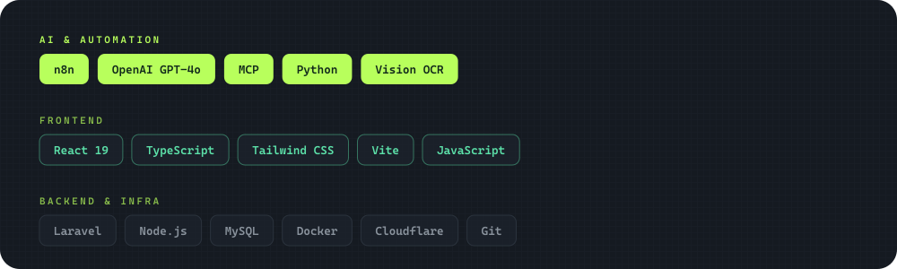

  
  
  
  

I build AI automations that turn messy manual work into self-running workflows, and the React interfaces people use on top of them.

My edge is **Arabic-first document AI**: n8n + LLM pipelines that read Arabic and English invoices, receipts, CVs and business cards, validate them, and push clean data into sheets, CRMs and dashboards.

Day to day I'm the **Technical Lead at DFS** in Al Khobar: I lead the engineering team and own the frontend hands-on, from planning and estimates to code review and release. I build with **Claude Code** every day.

Al Khobar, Saudi Arabia. Arabic and English.

### Building right now

- **A second CRM** — the company platform I built at DFS led a second company to ask our team for its own custom CRM. React + TypeScript, Arabic/English, I lead the frontend and delivery
- **Nour Motion Studio** — a motion-graphics video maker I built with Claude Code. It renders MP4 in your browser: no server, no API key
- **Claude as a manager** — a local Qwen 35B model writes code on my laptop, Claude plans and reviews it
- **My own Claude skills** — plus open-source ones from GitHub (`obra/superpowers`, `ponytail`, `anthropics/skills`) for planning, lean code and review

### Ask me about

- Getting an LLM to read Arabic documents reliably. The model is not the hard part.
- n8n in production: retries, idempotency, cost control, and when to stop using it
- Working with Claude Code every day: skills, MCP, and where a human must still sign off
- Running a small engineering team while still writing code

### What I've shipped

| Project | What it is | Stack |
| :--- | :--- | :--- |
| **[Smart Scanner](https://receipt.nexleadtech.com)** | Bilingual AR/EN invoice SaaS. I built the full frontend (3 role-based apps) and the n8n AI engine: 70+ fields per invoice in about 10 seconds, fraud and duplicate checks, ~75% lower AI cost by sending text PDFs to a text model instead of vision. | `React 19` `TypeScript` `n8n` `GPT-4.1 Vision` |
| **DFS Dashboard** | The CRM & quotation platform my company runs on, plus its quotation app. Quotes went from a manual process to under 2 minutes, used by all 15 employees. | `React 19` `Vite` `Tailwind v4` `TanStack Query` |
| **Universal Web Scraper** | Paste one URL, get the whole site as a categorized spreadsheet. Runs for days unattended. | `n8n` `OpenAI` `Google Sheets` |
| **[CV Screener](https://cv-screener.nouraldeentofi.com)** | Scores each CV per criterion with quoted evidence; the final ranking is computed in code, not by the model. | `Next.js` `n8n` `OpenAI` |
| **[Nour Motion Studio](https://nouraldeentofi.com/motion-studio/)** | 318 templates × 217 backgrounds × 349 transitions × 85 camera moves, exported to MP4 on your own device. | `JavaScript` `Canvas` `WebCodecs` |
| **MCP Servers** | Real data and profiles exposed as tools that Claude can call. | `MCP` `Node.js` |
| **Teacher Assistant Bot** | Telegram AI agent in production for a private tutor since 2025: students, schedules and dues, all through chat. | `n8n` `OpenAI` `MySQL` |
| **[The Complete Umrah Guide](https://nouraldeentofi.com/umrah-guide/)** | Bilingual offline PWA in one HTML file, 10 languages. | `PWA` `Web Speech API` |
| **[GoldenTag](https://play.google.com/store/apps/details?id=com.leadbridge.golden_tag)** | Jewelry store management app on Google Play: inventory, barcode scanning, live FX rates, sales logging. | `Play Store` `Delivery` |

**How I work:** automation should make business sense, not just demo well. Plain code where the logic must be exact, models only where they add value, and a human in the loop for anything that can't be undone.

### The website experiment

My portfolio is built for humans **and** AI agents. Every fact on it is machine-readable.

[`nouraldeentofi.com`](https://nouraldeentofi.com) &nbsp;·&nbsp; [`/llms.txt`](https://nouraldeentofi.com/llms.txt) &nbsp;·&nbsp; [`/api/profile.json`](https://nouraldeentofi.com/api/profile.json) &nbsp;·&nbsp; [`/mcp`](https://nouraldeentofi.com/mcp/README.md)

Ask ChatGPT or Claude *"Who is Nour Aldeen Tofi?"* and see what happens.

### Stack

Plus Claude Code, the Claude API and MCP every day. Laravel backend work with [Haitham Zedan](https://www.linkedin.com/in/haitham-zedan-391668221/).

### Contribution activity

  

<b>Have a process that should run itself, or need an Arabic-first AI workflow?</b> 
<a href="https://www.linkedin.com/in/nouraldeentofi">Message me on LinkedIn</a> or email <a href="mailto:nouraldeentofi@gmail.com">nouraldeentofi@gmail.com</a>

